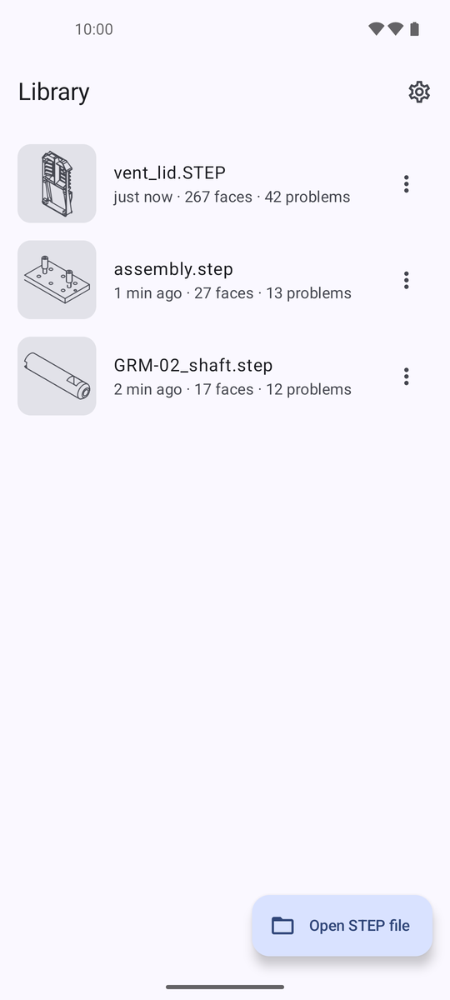
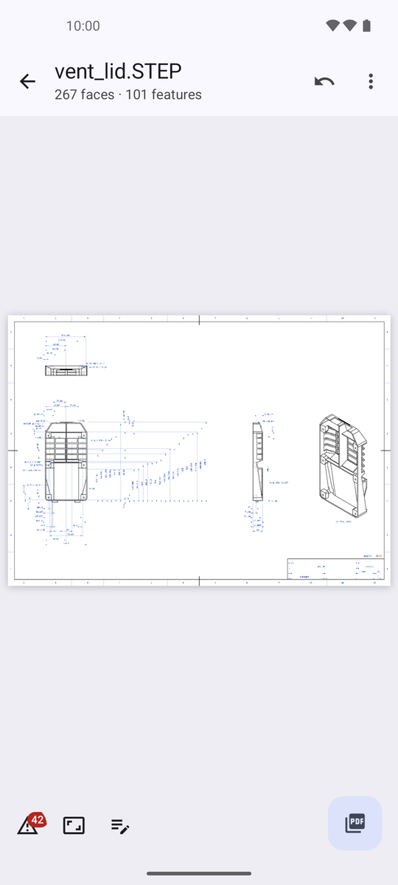
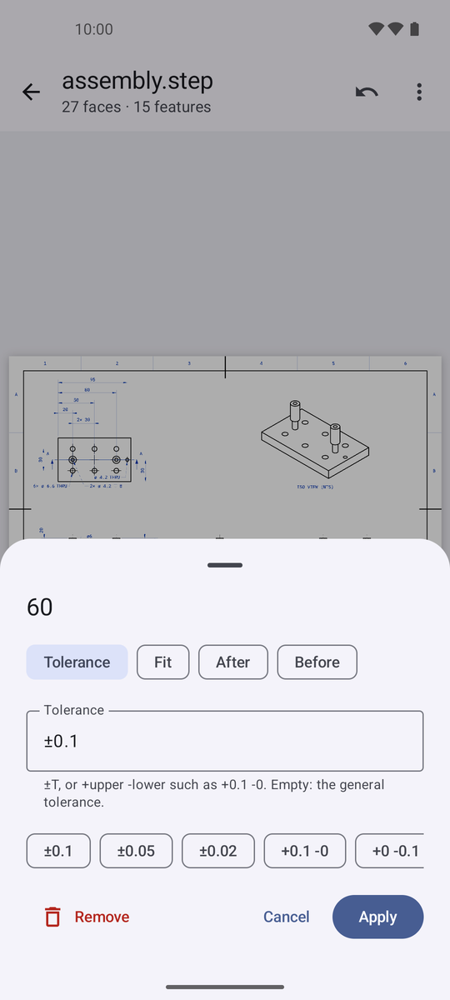
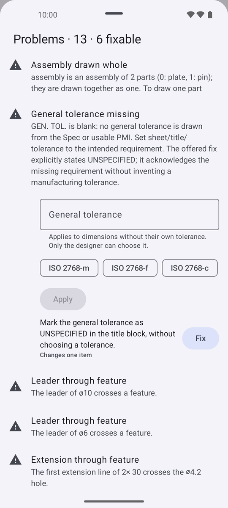
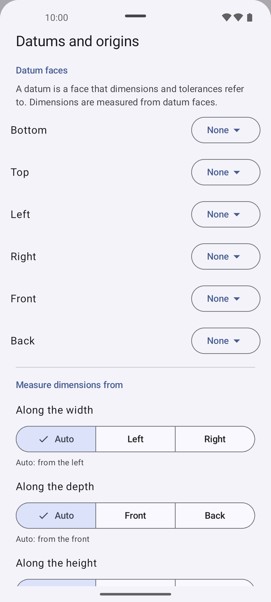
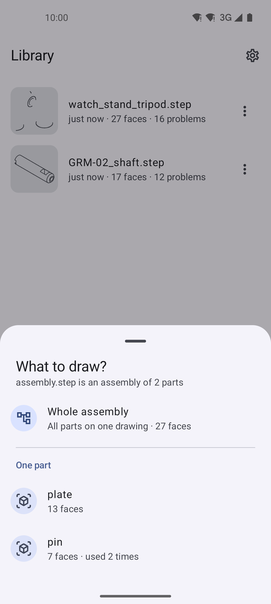
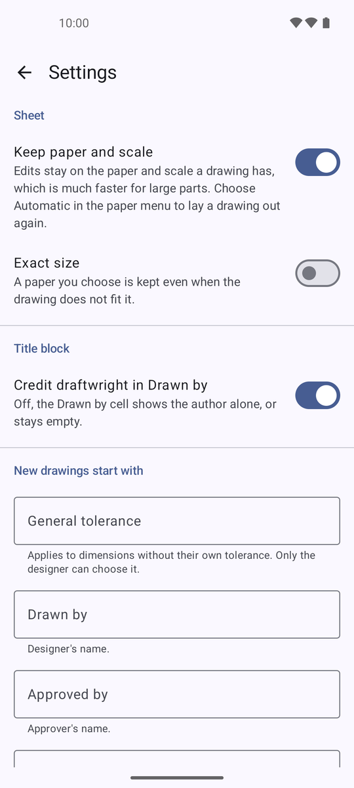
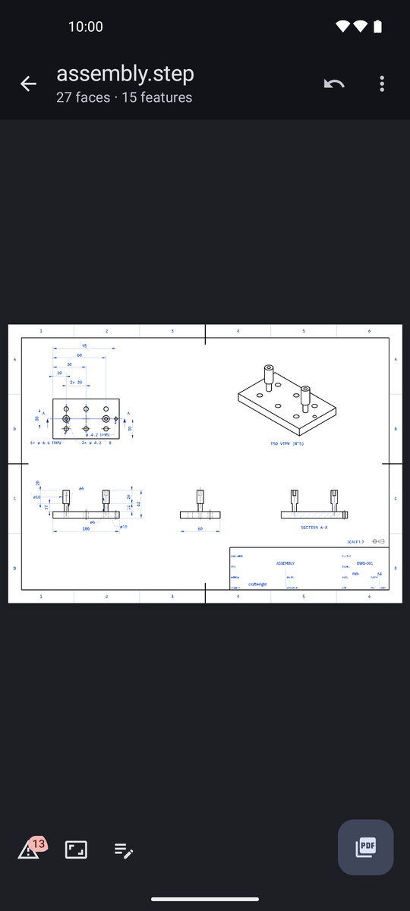

# Pocketdraft

**Engineering drawings from STEP models, made on your Android phone.**

Open a STEP file and Pocketdraft lays out the views, dimensions and title block of a
technical drawing for you, tells you what is still wrong with it, and lets you finish it with
a few taps: tolerances, datums, the title block, the paper. Then save it as a PDF.

Everything is computed on the phone. No account, no server, no network access, no
permissions.

<p align="center">
  
  
  
  
</p>
<p align="center">
  
  
  
  
</p>

## Features

- **Open STEP files** (`.step`, `.stp`) from the file picker or with "Open with" from another
  app. An assembly can be drawn whole or one part at a time.
- **Automatic drawing**: views, sections, an isometric view, dimensions, hole callouts and the
  title block, laid out on a standard paper size.
- **Problems with ready fixes**: the drawing lists what is wrong with it (overlapping labels,
  a missing general tolerance, …) and offers fixes you apply with one tap.
- **Edit by tapping the drawing**:
  - a dimension: tolerance, fit, text before and after, or remove it (and put it back later);
  - a face of the part: make it a datum (A, B, C…);
  - a title-block cell: fill it in.
- **Datums and origins**: choose which faces are datums and where dimensions are measured from.
- **Paper**: automatic, or a size you choose; "Keep paper and scale" keeps edits fast on
  large parts.
- **PDF export** of every sheet, with embedded fonts, and **DXF** of a sheet for a CAD program.
- **Library** of your drawings, each with its edits, kept between sessions.
- **Material You**: follows the system's colours and dark theme.

## Install

Pocketdraft needs Android 8.0 or later on a 64-bit ARM phone (practically every phone from the
last years).

- **F-Droid**: submission in preparation.
- **From source**: build it as described below.

## How to use it

1. Tap **Open STEP file** and pick a model. For an assembly, choose the whole assembly or
   one part.
2. Wait for the drawing: a small part takes a second or two; a part with a few hundred faces
   takes tens of seconds the first time.
3. Pinch to zoom, drag to move, double-tap to fit the sheet.
4. Tap anything on the drawing to edit it: a dimension, a face of the part, a title-block
   cell.
5. The **problems** button (bottom left, with a count) lists what is still wrong; open a
   problem to see its fixes.
6. The **paper** button chooses the sheet size; the **title block** button opens the title
   block; the **⋮** menu holds datums and origins, hidden lines, removed dimensions, Save as
   DXF and Settings.
7. **Undo** (top bar) takes back any edit. The **PDF** button saves the drawing.

Drawings stay in the library with their edits. Settings (gear in the library, or ⋮ →
Settings) also set the title-block values every new drawing starts with.

## Build from source

Pocketdraft is a Kotlin app (Jetpack Compose, Material 3) over a Rust layer that calls the
drawing core. One Gradle command builds both, on Linux, macOS or Windows.

**Requirements**

- JDK 17 or later (`JAVA_HOME`)
- Android SDK (`ANDROID_HOME`, or `sdk.dir` in `android/local.properties`); Gradle installs
  the NDK version the build asks for (27.1.12297006) when the SDK licences are accepted
- Rust through [rustup](https://rustup.rs): `rust/rust-toolchain.toml` pins the version and
  the Android targets, so rustup installs them on first use
- cargo-ndk: `cargo install cargo-ndk --version 4.1.2 --locked`
- a C compiler for the host (`gcc` or `clang` on Linux and macOS; Visual Studio Build Tools on
  Windows), as Rust build scripts need one

**Build**

```sh
git clone https://github.com/0ndrec/pocketdraft.git
cd pocketdraft/android
./gradlew :app:assembleRelease -PdebugSigned
```

On Windows use `gradlew.bat`. The APK is in `android/app/build/outputs/apk/release/`.
Install it with `adb install -r app/build/outputs/apk/release/app-release.apk`.

| Command | Builds |
|---|---|
| `./gradlew :app:assembleRelease` | an unsigned release APK (as F-Droid builds it) |
| `./gradlew :app:assembleRelease -PdebugSigned` | a release APK signed with the debug key, to install |
| `./gradlew :app:assembleDebug` | a debug APK |
| `./gradlew :app:assembleRelease -Pabi=x86_64 -PdebugSigned` | for an x86_64 emulator |

The first build compiles the drawing core and takes about ten minutes; later builds take
seconds to a minute.

**Tests**

```sh
cd rust
RUST_MIN_STACK=268435456 cargo test --release --lib
```

## Documentation

- [docs/DEVELOPMENT.md](docs/DEVELOPMENT.md): how the app is put together, how to add a
  feature, testing, known traps, and a reference of the Rust interface.
- [docs/performance.md](docs/performance.md): measurements with a large model and the
  options they led to.
- [CONTRIBUTING.md](CONTRIBUTING.md): what a change needs.
- [docs/fdroid/app.pocketdraft.yml](docs/fdroid/app.pocketdraft.yml): the F-Droid build
  recipe.

## The drawing core

The drawings are made by [draftwright](https://github.com/pzfreo/draftwright-rust), used as
released and unmodified. Pocketdraft is an independent app built on it and is not affiliated
with draftwright's author. By default the title block's "Drawn by" cell credits draftwright,
as the core writes it; Settings can turn that off.

## Licence

[AGPL-3.0-only](LICENSE), the licence of the draftwright core.
